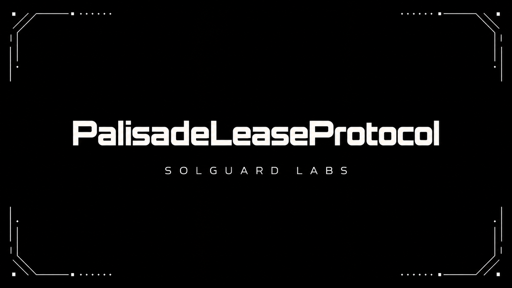
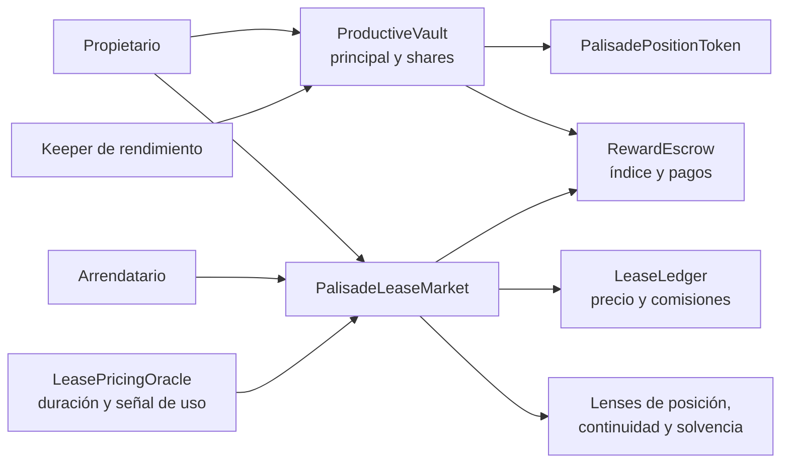

# PalisadeLeaseProtocol



Palisade es un mercado de cesión temporal del rendimiento de posiciones
productivas. El propietario mantiene el principal depositado en
`ProductiveVault`, mientras el arrendatario adquiere durante un plazo
definido los derechos de rendimiento asociados a la posición. Precio,
duración, comisiones y permisos forman parte de cada oferta.

## Arquitectura



El mercado registra ofertas y el ciclo de cada lease. El vault conserva el
principal y bloquea la posición durante un lease activo. El escrow recibe
harvests y mantiene un índice global de rendimiento; el ledger conserva los
créditos de precio del propietario y de comisiones. `LeaseRiskController` es
una política auxiliar opcional para integradores, no un guard automático del
mercado principal.

## Economía del lease

El precio base se expresa por día y se ajusta por duración y por una señal de
utilización basada en peso productivo e índice de rendimiento. La cotización
se redondea hacia arriba por duración; comisiones y reparto se calculan en
puntos básicos. El rendimiento financiado incrementa el índice global según
el peso total del vault y se contabiliza en unidades enteras del activo.

```text
precio_plazo = ceil(precio_diario_ajustado × segundos / 86.400)
comisión     = floor(precio_plazo × comisión_bps / 10.000)
delta_índice = floor(recompensa_distribuible × 1e27 / peso_total)
rendimiento  = floor(peso_posición × delta_índice / 1e27)
```

Por ejemplo, una oferta de 10 tokens por día durante 7 días, sin ajuste de
utilización, cotiza 70 tokens. Una comisión de 200 bps representa 1,4 tokens;
con cargo al propietario y sin otras comisiones, el crédito del propietario es
68,6 tokens. La cotización efectiva debe consultarse con `quote`, porque
depende de los parámetros y del índice del bloque de referencia.

Documentación: [arquitectura](docs/arquitectura.md),
[modelo económico](docs/modelo-economico.md),
[integración](docs/integracion.md),
[operación](docs/operacion.md) y [riesgo](docs/riesgo.md).

## Desarrollo local

Requiere Foundry con `forge` y Solidity 0.8.26. El script de bootstrap
descarga `forge-std` en `lib/`, que no se versiona.

```bash
bash scripts/bootstrap.sh
forge build
forge test -vv
bash scripts/ci.sh
```

En PowerShell puede usar `forge build` y `forge test -vv` directamente. Para
`forge fmt --check`, use un checkout con finales de línea LF, conforme a
`.gitattributes`. La CI ejecuta bootstrap, formato, compilación y pruebas en
Ubuntu para PR, `main`, `production` y etiquetas estables.

## Recorrido de integración

1. El propietario deposita un activo en `ProductiveVault`, recibe el token de
   posición y crea una oferta con `list`.
2. El cliente consulta `quote(positionId, duration)` y aprueba al mercado el
   token de pago por el importe máximo aceptado.
3. El arrendatario llama a `openLease`; el principal queda bloqueado y el
   precio se acredita en `LeaseLedger`.
4. El keeper ingresa rendimiento mediante `harvestRewards`. El arrendatario
   consulta `pendingRewards` y, si procede, llama a `claimRewards`.
5. Al concluir el plazo, `settleExpiredLease` actualiza el estado y libera
   la posición cuando no existe continuación activa.

Las vistas `PalisadeLens`, `LeaseScenarioLens`, `LeaseCashflowLens` y
`PalisadeInvariantLens`
ayudan a componer pantallas y reconciliaciones. Sus muestras dependen de los
IDs suministrados y no sustituyen la revisión del estado completo.

## Componentes

| Ruta | Responsabilidad |
| --- | --- |
| `src/market/` | Ofertas, apertura, renovación y cierre de leases |
| `src/vault/` y `src/token/` | Custodia, shares y titularidad de posiciones |
| `src/rewards/` | Financiación e índice de rendimiento |
| `src/accounting/` | Créditos de precio y diarios auxiliares |
| `src/pricing/` | Cotizaciones deterministas por plazo |
| `src/policy/` | Política opcional para integraciones |
| `src/views/` | Consultas compuestas, proyección de cashflow y reconciliación por muestra |
| `test/` | Flujos de mercado, tesorería, pausas y custodia |

## Versión y seguridad

`Production 1.0.0` identifica el código versionado y sus validaciones, no un
despliegue en una red con fondos. La rama `production` y la etiqueta anotada
`v1.0.0` deben resolver al commit estable de `main`. Consulte
[SECURITY.md](SECURITY.md) para el modelo de confianza y el reporte
coordinado. Licencia MIT en [LICENSE](LICENSE).
