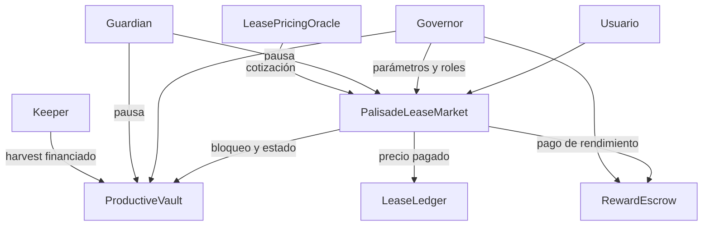

# Política de seguridad

Palisade separa custodia de principal, derechos de rendimiento, precio de
lease y créditos de pago. La seguridad de una integración depende de la
configuración de roles, el estado de cada contrato y la vigencia de la
cotización. Las pruebas automatizadas son una barrera de regresión, no una
certificación externa.

## Fronteras de confianza

El governor configura contratos, roles y parámetros. El guardian puede
pausar los componentes que exponen esa capacidad. Solo el mercado autorizado
puede bloquear o desbloquear posiciones en el vault y ordenar pagos en el
escrow; solo el vault autorizado puede notificar rendimiento. Las rutas de
salida de tokens usan protección contra reentrada y comprueban importes,
destinatarios y saldo o crédito disponible.

## Controles a verificar

| Dominio | Control | Evidencia local |
| --- | --- | --- |
| Principal | Posición bloqueada durante lease activo | Prueba de retiro rechazado |
| Mercado | Precio máximo aceptado por arrendatario | Prueba de cotización y apertura |
| Pausa | Guardian restringe nuevas aperturas | Prueba de pausa del mercado |
| Ledger | Suma de créditos cubierta por saldo | Prueba de reparto y lente |
| Rendimiento | Pago limitado por balance financiado | Estado de escrow y prueba de claim |
| Tiempo | Renovación y expiración siguen ventanas | Pruebas de continuidad y cierre |

`PalisadeInvariantLens` verifica muestras elegidas por el operador; no recorre
automáticamente todas las posiciones ni bloquea operaciones. Del mismo modo,
`LeaseRiskController` es una política auxiliar: un integrador debe invocarlo
expresamente si desea aplicar sus límites.

## Cambios y dependencias

Un cambio de contrato debe compilar, pasar `forge fmt --check` y superar las
pruebas. Revise parámetros de duración, comisiones, descuentos, roles y
direcciones antes de aplicar una configuración. Dependabot cubre GitHub
Actions; `forge-std` se instala durante bootstrap y debe revisarse al cambiar
de versión. La publicación estable requiere comprobar PR fusionado, CI de
`main`, `production` y tag, etiqueta anotada e integridad del release.

## Reporte coordinado

Use el canal privado de seguridad de GitHub si está habilitado. Indique commit,
precondiciones, activos afectados, transiciones de estado, efecto económico,
pasos de reproducción y pruebas o trazas locales. No publique detalles
técnicos sensibles en issues abiertas antes de coordinar la revisión. Este
repositorio no declara custodia de fondos externos ni despliegue on-chain.
