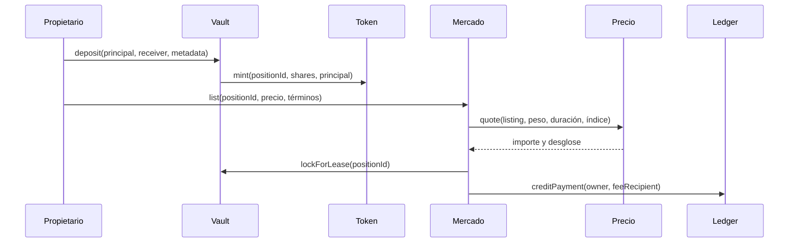

# Arquitectura de Palisade

## Estado y responsabilidades

`ProductiveVault` mantiene el principal ERC20, emite shares y registra el peso
productivo de cada posición. `PalisadePositionToken` representa titularidad y
metadatos; una posición en lease queda congelada para operaciones de
principal. `PalisadeLeaseMarket` conserva ofertas y leases, consulta el módulo
de precio y coordina cobro, bloqueo y pagos de rendimiento. `RewardEscrow`
recibe harvests y publica el índice global; `LeaseLedger` conserva créditos
retirables de precio y comisiones.

La transferencia del token de pago del arrendatario al ledger ocurre durante
`openLease`. Las vistas de estado pueden quedar obsoletas entre lectura y
transacción; el mercado vuelve a cotizar y comprueba `maxPrice`.

## Módulos auxiliares

`LeaseOfferBook` modela ofertas y reembolsos separados del mercado principal.
`LeaseRiskController` ofrece validaciones opcionales a integradores.
`PalisadeLens` agrega vistas, `LeaseScenarioLens` construye escenarios de
índice y `PalisadeInvariantLens` reconcilia muestras de principal, ledger y
escrow. Ninguna lente cambia saldos; la muestra debe elegirla el operador y
no debe interpretarse como cobertura global automática.

## Roles

El governor puede actualizar parámetros y componentes configurables. El
guardian tiene potestad de pausa donde el contrato la expone. El keeper
financia harvests con tokens aprobados al vault. Mercado, vault, ledger y
escrow se autorizan mutuamente durante la configuración; un despliegue local
incompleto debe detectarse antes de aceptar operaciones de usuarios.
