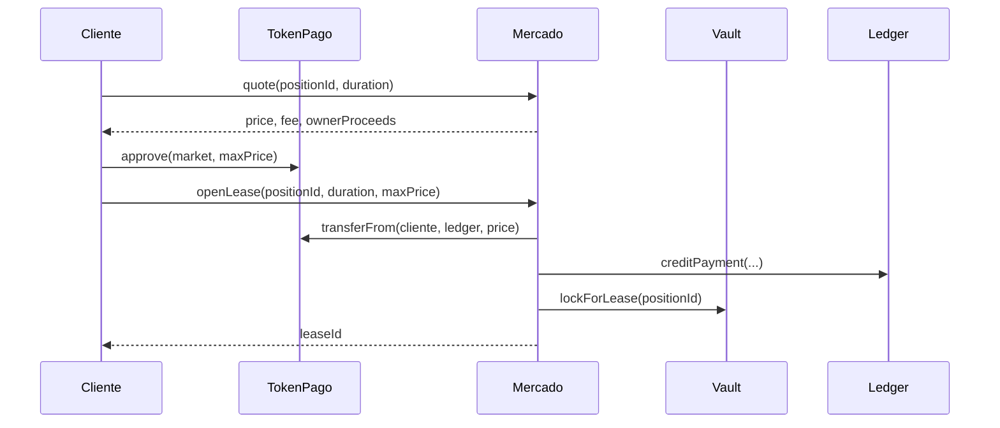

# Integración

## Preparación local

```bash
bash scripts/bootstrap.sh
forge build
forge test -vv
```

Foundry descarga `forge-std` en `lib/`; el directorio se ignora en Git. El
proyecto compila con Solidity 0.8.26 y objetivo EVM Cancún. `script/DeployPalisade.s.sol`
lee configuración del entorno; inspecciónelo y fije parámetros explícitos
antes de cualquier ejecución. La compilación y las pruebas locales no
requieren RPC ni credenciales.

## Flujo de aplicación

Una interfaz debe leer `listingOf(positionId)` y `quote(positionId, duration)`
antes de construir una transacción. La cotización incorpora duración, índice
y parámetros del momento. El arrendatario aprueba el token de pago al mercado
y llama a `openLease` con `maxPrice` como protección de precio. Después
consulta `leaseOf`, `activeLeaseFor` y `pendingRewards` para presentar estado.



Al presentar un lease distinga estado registrado (`Active`, `Expired`,
`Settled`) de actividad temporal efectiva: `isLeaseActive` también compara
`block.timestamp` con `start` y `end`. Una continuación puede estar creada
antes de su inicio.

## Errores y unidades

Trate como recuperables los rechazos por expiración de oferta, duración
fuera de términos, precio superior al máximo, saldo insuficiente, pausa o
posición ya bloqueada. Los importes ERC20 son enteros en la unidad mínima del
token. `duration`, `start` y `end` están en segundos Unix; las comisiones
se expresan en bps. No derive un saldo de rewards solo a partir de eventos:
vuelva a consultar el contrato en el bloque de interés.
