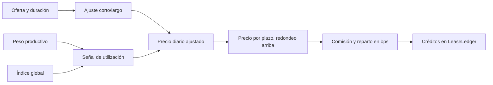

# Modelo económico del lease

## Principal y shares

Un depósito convierte activos a shares. Si el vault está vacío, el primer
depósito recibe una share por unidad; posteriormente se usa la proporción
`assets × totalShares / totalPrincipal`, truncada hacia abajo. El rescate
invierte la proporción. El principal custodiado no se transfiere al
arrendatario: el lease cede temporalmente derechos de rendimiento.

## Cotización

`LeasePricingOracle` parte del precio diario de la oferta. Para plazos por
debajo de `targetDuration` añade una prima proporcional al déficit de tiempo;
para plazos más largos aplica un descuento acotado por la oferta y respeta
`minPricePerDay`. Una señal basada en raíz cuadrada del peso productivo y del
índice global añade una prima de utilización limitada por `maxPremiumBps`.



Las tasas se expresan en puntos básicos (`10.000 = 100 %`). El lado de la
comisión (`Owner`, `Lessee` o `Split`) determina quién soporta cada parte de
la cotización. No suponga que `ownerProceeds` y `price` serán iguales; use
`quote` para mostrar el desglose efectivo antes de aprobar tokens.

## Rendimiento

El keeper transfiere rewards al vault, que descuenta la comisión de harvest
configurada y financia `RewardEscrow`. Si existe peso productivo, el escrow
incrementa su índice en escala `1e27`:

```text
delta_índice = floor(distribuible × 1e27 / peso_total)
rewards_estimadas = floor(peso_posición × delta_índice / 1e27)
```

El residuo que no cabe en el índice se conserva como `undistributed` para
una notificación posterior. `totalFunded`, `totalPaid` y el balance ERC20
permiten verificar financiación y pagos. Para un único peso de 1.000 shares,
un harvest neto de 80 tokens produce un incremento de índice de
`80 × 1e27 / 1.000` y 80 tokens de rewards atribuibles antes de otros
cambios de estado.

## Alcance de las proyecciones

`LeaseCashflowLens` permite comparar el alquiler cotizado con una previsión de
rewards y un multiplicador de retención de 1 a 10.000 bps. Devuelve cobertura,
excedente o déficit para el arrendatario y la previsión de rewards necesaria
para alcanzar equilibrio bajo ese estrés. También anualiza en bps el ingreso
del propietario frente al principal y la duración. Son escenarios de interfaz:
no crean derechos de cobro ni alteran contratos de estado.

Las lentes calculan sobre IDs y snapshots facilitados por la integración.
No anticipan nuevas cosechas, cambios de parámetros, movimientos de shares o
transacciones concurrentes. Los redondeos son enteros y deben mostrarse con
los decimales reales del token de pago y del activo productivo.
