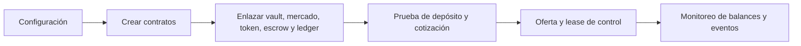

# Operación

## Alta y revisión de parámetros

Antes de habilitar el mercado, verifique direcciones de token, vault,
position token, escrow, oracle de precio y ledger. Compruebe que `setMarket`
y `setVault` señalan a los contratos correspondientes, que el governor y el
guardian están identificados, y que los límites de depósito, plazo y
comisión se ajustan al activo. El script de despliegue muestra el orden de
instalación; las pruebas verifican una configuración local completa.

## Observabilidad

Conserve por bloque las referencias de posición, oferta, lease, pago,
harvest y claim. Reconcilie `vault.totalPrincipal` con posiciones muestreadas;
compare `ledger.totalCredits(token)` con el saldo ERC20 del ledger; y
compare rewards financiadas, pagadas y balance del escrow. Las lentes de
invariantes informan sobre la muestra suministrada: registrar la lista de IDs
es parte de la evidencia operativa.

## Pausa e incidentes

Ante una anomalía, capture contratos, bloque, configuración, saldos y eventos
antes de intervenir. Determine si procede pausar nuevas ofertas, leases,
claims, depósitos o harvests; son capacidades distintas. Evalúe el efecto
de la pausa sobre saldos pendientes y usuarios existentes. Documente todo
cambio de governor, guardian, keeper y direcciones de componentes.

## Release

Una versión estable exige PR revisado y fusionado, CI verde, tag anotado y
release publicado. Compare `main`, `production` y `v1.0.0^{}`; el objeto
de tag debe ser de tipo `tag`. Un release de código no demuestra que exista
un despliegue en una red ni que sus parámetros coincidan con una instancia
externa.
