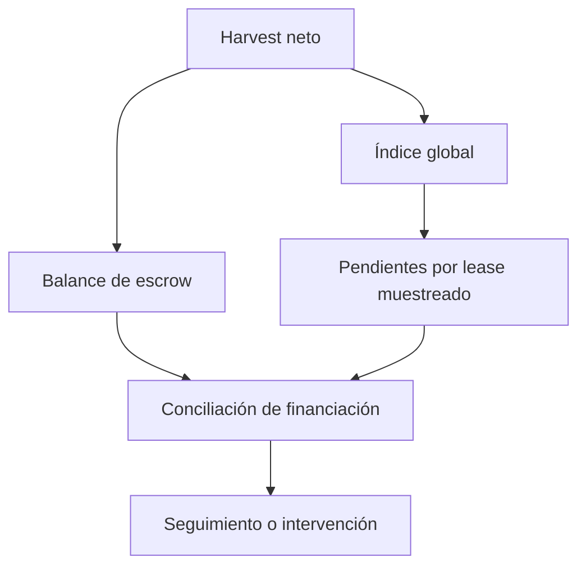

# Riesgos y controles

## Riesgo de mercado

Una posición productiva expone al propietario al bloqueo temporal del
principal y al arrendatario a variación del rendimiento futuro. La
cotización depende de duración, configuración y señal del índice; el
rendimiento no está garantizado por el precio pagado. Un token de pago con
decimales distintos del activo productivo requiere conversión explícita en
la interfaz.

| Riesgo | Señal | Control operativo |
| --- | --- | --- |
| Precio inesperado | `quote.price > maxPrice` | Releer y exigir aprobación del usuario |
| Posición inmovilizada | `isPositionLocked = true` | Mostrar plazo y estado del lease |
| Escrow insuficiente | balance frente a rewards pendientes muestreadas | Conciliar y detener nuevas decisiones dependientes |
| Oferta caducada | `expiresAt < block.timestamp` | Retirar la oferta de la interfaz |
| Parámetro alterado | evento de configuración | Recalcular cotizaciones y límites |

## Modelo de financiación

`RewardEscrow` solo puede pagar tokens presentes. Su índice mide rewards
distribuidas por unidad de peso, mientras `undistributed` retiene redondeos
o fondos notificados sin peso. El operador debe contrastar `totalFunded`,
`totalPaid`, balance y muestras de derechos pendientes. Una muestra solvente
no equivale a conciliación exhaustiva de todas las posiciones.

## Límites del análisis

Las lentes son consultas y no aplican pausas ni revocan pagos.
`LeaseCashflowLens` tampoco garantiza rentabilidad: la previsión de harvest
y la retención introducidas por el usuario son hipótesis. Una integración
que utilice `LeaseRiskController` debe llamar a sus funciones
de validación de forma expresa. Ninguna simulación local anticipa nuevas
rewards, cambios de roles o transacciones concurrentes; para decidir una
operación use el estado más reciente y simule la transacción completa.
